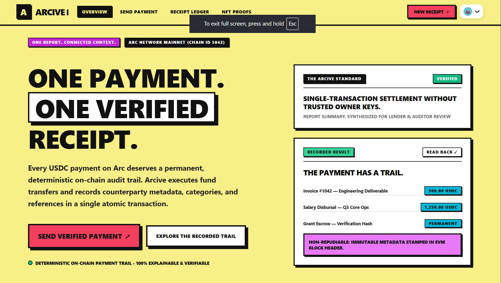

# Arcive 📜

**Permanent, verifiable on-chain receipts and NFT proofs for every USDC payment on Arc Mainnet.**

<!-- 📸 MAIN SHOWCASE IMAGE: save your image as public/showcase.png (recommended 1600x900) -->
<p align="center">
  
</p>

[](https://explorer.arc.io)
[](#-arc-mainnet-parameters)
[](./LICENSE)

| | |
|---|---|
| 🔗 **Live app** | <https://arcive-delta.vercel.app> |
| 📜 **Contract** | [`0x4664cf917157735081c3ba095733a85ade5beb0f`](https://explorer.arc.io/address/0x4664cf917157735081c3ba095733a85ade5beb0f) |
| 🔍 **Deployment tx** | [`0x988bec74…c0c992`](https://explorer.arc.io/tx/0x988bec746bdbe268c304461c91a324fcd19b0942bb3e7517f0c0093119c0c992) |
| 🎬 **Demo video** | [Watch on YouTube](https://youtu.be/-M5GomP-JFs) |

### 🎬 Demo

[](https://youtu.be/-M5GomP-JFs)
---

## What is Arcive?

A normal USDC transfer tells you *who paid whom and how much*. It doesn't tell you **why**. Arcive adds the missing context.

Every payment sent through Arcive is recorded on-chain with the counterparty, amount, a category (Invoice, Salary, Subscription, Loan repayment, and more) and a short reference note. In the same transaction, the payer receives an **ERC-721 certificate** whose artwork is an SVG generated entirely on-chain.

On top of that sits an app with a filterable ledger and a one-click, accountant-ready CSV export, so the payment history is useful for bookkeeping.

**Who it's for:** freelancers, small teams, DAOs, and anyone who needs clean, verifiable payment records without a spreadsheet and a screenshot folder.

---

## ⚡ How Arcive uses Arc

- **Native USDC for payment and gas.** Users pay for the transfer and for gas in USDC. There is no second token to acquire first.
- **One atomic transaction.** A single `pay()` call in `ArciveNFT.sol` transfers the USDC, stores the receipt, and mints the NFT. Either all of it happens or none of it does.
- **Verifiable by anyone.** Receipts are readable directly from the contract (`getReceipt`), inspectable on the Arc explorer, and the certificate image is embedded in `tokenURI` as base64 SVG, with no external hosting or IPFS dependency.

---

## 🚀 Features

**Payments**
- Dashboard with balance overview, recent payment feed, and a quick-send form
- Structured metadata: counterparty, category, and a reference note of up to 140 characters

**Receipts**
- Permanent receipt page at `/receipt/[id]` with explorer verification and image export

**History**
- `/history` ledger filterable by direction (sent or received), category, and date range

**CSV export**
- One-click export with ISO timestamps and 6-decimal USDC precision
- Protected against spreadsheet formula injection (cells beginning with `=`, `+`, `-`, or `@` are escaped)
- UTF-8 BOM so the file opens correctly in Excel

**NFT gallery**
- `/gallery` shows mintable proof-of-payment ERC-721 certificates
- On-chain SVG rendered straight from `tokenURI` metadata
- "Add to Wallet" support via EIP-747 for MetaMask and Rainbow
- Direct links to contract and token pages on the explorer

---

## 🧱 Architecture

```
Arcive/
├── app/         Next.js app router pages (dashboard, history, receipt, gallery)
├── contracts/   ArciveNFT.sol
├── lib/         Chain config, contract bindings, helpers
├── scripts/     Compile and deploy scripts
└── public/      Static assets
```

**Stack:** Next.js, TypeScript, wagmi + viem, Solidity, Hardhat.

### `ArciveNFT.sol`

| Function | Purpose |
|---|---|
| `pay(address payee, uint256 amount, string category, string note)` | Transfers USDC to `payee`, records the receipt, and mints an ERC-721 certificate to the payer |
| `getReceipt(uint256 id)` | Returns `Receipt(payer, payee, amount, category, note, timestamp)` |
| `idsByPayer(address)` / `idsByPayee(address)` | Receipt IDs for an address, so no off-chain indexer is needed |
| `totalReceipts()` | Total number of receipts recorded |
| `tokenURI(uint256 tokenId)` | JSON metadata with the embedded on-chain SVG |
| `ownerOf(uint256 tokenId)` | Current owner of a certificate |

---

## 🌐 Arc Mainnet parameters

| Parameter | Value |
|---|---|
| Network | Arc Mainnet |
| Chain ID | `5042` |
| RPC | `https://rpc.mainnet.arc.io` |
| Gas currency | USDC (18 decimals) |
| USDC token | `0x3600000000000000000000000000000000000000` |
| Block explorer | <https://explorer.arc.io> |

---

## 🛠️ Getting started

### Prerequisites
- Node.js 18+
- npm or pnpm
- A wallet with a small amount of USDC on Arc (needed for gas)

### Install and run

```bash
git clone https://github.com/Lakshay-Deol/Arcive.git
cd Arcive
npm install
cp .env.example .env.local
npm run dev
```

Open <http://localhost:3000>.

### Environment variables

```env
NEXT_PUBLIC_CHAIN_ID=5042
NEXT_PUBLIC_RPC_URL=https://rpc.mainnet.arc.io
NEXT_PUBLIC_ARCIVE_NFT_CONTRACT=<deployed contract address>
NEXT_PUBLIC_ARCIVE_CONTRACT=<deployed contract address>
NEXT_PUBLIC_USDC_ADDRESS=0x3600000000000000000000000000000000000000
NEXT_PUBLIC_EXPLORER_URL=https://explorer.arc.io
```

### Compile contracts

```bash
npm run compile
```

### Deploy your own instance

The deploy script reads the key from an environment variable at run time. Never commit it.

```bash
# macOS / Linux
DEPLOYER_PRIVATE_KEY=0xYOUR_KEY npm run deploy:mainnet
```

```powershell
# Windows PowerShell
$env:DEPLOYER_PRIVATE_KEY="0xYOUR_KEY"
npm run deploy:mainnet
```

The script broadcasts the contract, checks the balance, verifies the receipt, and updates `.env.local` with the new address.

### Production build

```bash
npm run build
```

Deployed on Vercel. Set the environment variables above in your project settings.

---

## 🔐 Security and limitations

Arcive is an early-stage project built to prove the concept on Arc mainnet. Please read this before using it with real funds.

- **Receipt notes are public.** Categories and notes are stored on-chain in plaintext, so anyone can read them. Don't put confidential information in a note.
- **Not audited.** The contract has not had a third-party security audit. Use it at your own risk and with amounts you're comfortable with.
- **Certificates go to the payer.** The ERC-721 proof is minted to the sender. The payee can still look up the receipt on-chain through `idsByPayee`.
- **Arc network risk.** Arc is a new network, and its own disclosures apply to anything built on it.

Found a vulnerability? Please open a GitHub issue or contact the maintainer privately before disclosing it publicly.

---


## 🤝 Contributing

Issues and pull requests are welcome. For larger changes, please open an issue first to discuss what you'd like to change.

## 📄 License

[MIT](./LICENSE) © Lakshay Deol

---

*Built for Arc. Every payment, on the record.*
